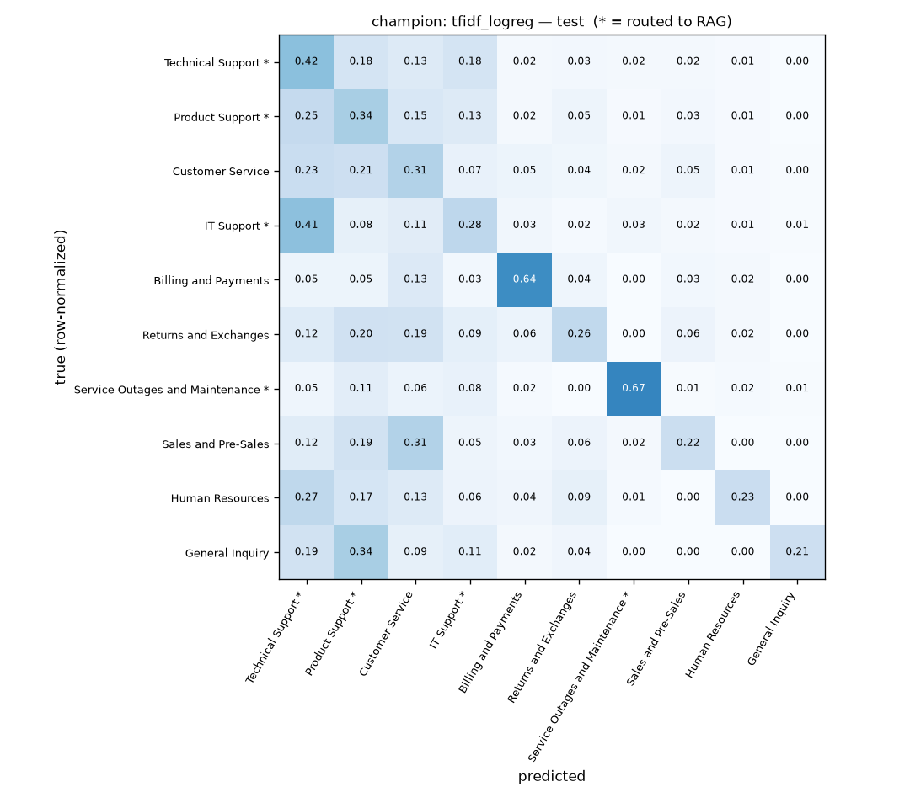

# Model selection — ticket triage

Generated by `python -m support_copilot.model.train` · seed 42 · paired stratified-grouped 5-fold CV on train (paraphrase families never straddle folds), single evaluation on a group-disjoint test set.

| candidate | CV macro F1 | test accuracy | test macro F1 | test weighted F1 | routing F1 (test) |
|---|---|---|---|---|---|
| majority | 0.045 ± 0.000 | 0.290 | 0.045 | 0.130 | 0.389 |
| tfidf_logreg **(champion)** | 0.332 ± 0.008 | 0.383 | 0.371 | 0.385 | 0.693 |
| tfidf_linearsvc | 0.314 ± 0.007 | 0.400 | 0.348 | 0.385 | 0.668 |
| tfidf_xgboost | 0.315 ± 0.015 | 0.373 | 0.341 | 0.373 | 0.686 |

Champion = non-baseline candidate with the highest mean CV macro F1 (the test set does not pick it).

## Champion vs runner-up (paired by fold)

- Runner-up: `tfidf_xgboost`
- Delta CV macro F1: +0.0178 ± 0.0141 · champion wins 5/5 folds

## Where the champion's errors live (test)

| bucket | errors | share |
|---|---|---|
| within technical queues | 829 | 41.2% |
| within non-technical queues | 263 | 13.1% |
| across the routing boundary | 922 | 45.8% |
| **total** | 2014 | of 3266 test tickets |

Only errors across the routing boundary change whether a ticket reaches the RAG.

## Champion per-queue F1 (test)

| queue | technical | F1 | support |
|---|---|---|---|
| Technical Support | yes | 0.430 | 947 |
| Product Support | yes | 0.341 | 614 |
| Customer Service |  | 0.293 | 482 |
| IT Support | yes | 0.259 | 388 |
| Billing and Payments |  | 0.669 | 319 |
| Returns and Exchanges |  | 0.276 | 163 |
| Service Outages and Maintenance | yes | 0.652 | 133 |
| Sales and Pre-Sales |  | 0.217 | 103 |
| Human Resources |  | 0.267 | 70 |
| General Inquiry |  | 0.308 | 47 |

